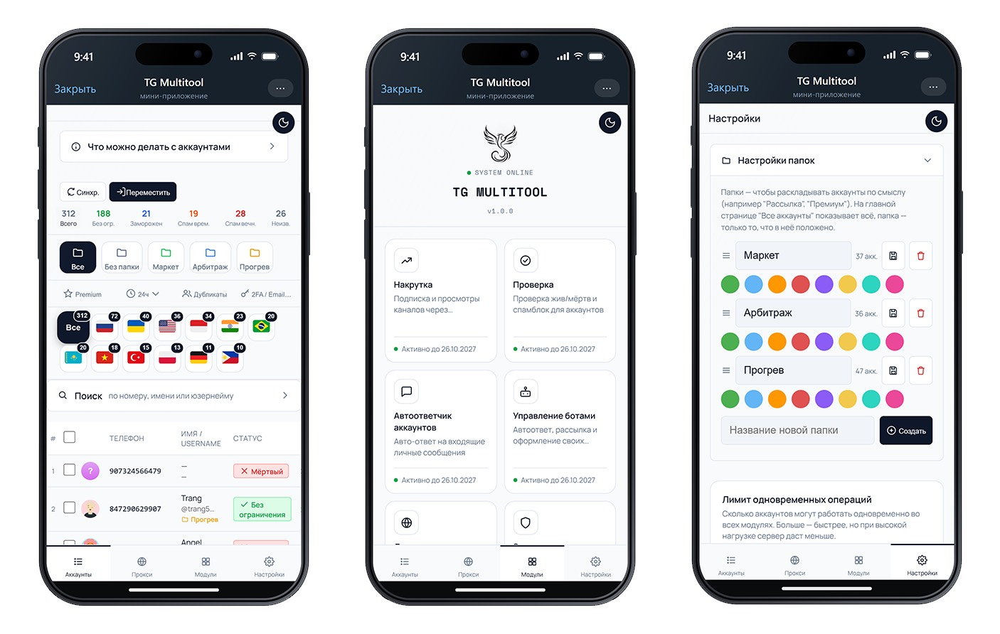

# TG Multitool - открытые инструменты для сессий Telegram

[](https://www.python.org/)
[](https://github.com/LonamiWebs/Telethon)
[](LICENSE)

Два небольших открытых скрипта на Python для работы с сессиями Telegram:
вход по номеру телефона и конвертация tdata (Telegram Desktop) в файл
сессии Telethon. Публикует команда **TG Multitool** -
[tgmultitool.com](https://tgmultitool.com) - мини-приложение в Telegram
с инструментами для управления аккаунтами, каналами и ботами.

## Инструменты

### 1. `session_login.py` - вход по номеру телефона

Вводите номер → код из Telegram → пароль (если включена двухфакторная
защита) → получаете файл `<телефон>.session`, готовый для использования
в любом своём скрипте на Telethon.

```bash
pip install -r requirements.txt
export TG_API_ID=ваш_api_id       # получить на my.telegram.org
export TG_API_HASH=ваш_api_hash
python session_login.py +79991234567
```

### 2. `tdata_to_session.py` - конвертер tdata → .session

Если у вас уже есть аккаунт, авторизованный в Telegram Desktop, скрипт
достаёт готовую авторизацию из папки `tdata` и сохраняет её как файл
сессии Telethon - без повторного ввода кода. Основан на библиотеке
[opentele](https://github.com/thedemons/opentele).

```bash
python tdata_to_session.py "C:/Users/you/AppData/Roaming/Telegram Desktop/tdata" my_account
```

Папка `tdata` не изменяется - скрипт только читает её.

## Откуда взялись эти скрипты

Это часть того, что мы сделали для своего мини-приложения **TG Multitool**
и решили выложить отдельно, без привязки к остальному сервису. Если вам
нужна не разовая конвертация, а постоянная работа с несколькими
аккаунтами - в мини-приложении есть более широкий набор модулей
(названия - как в самом интерфейсе):



Полный список модулей и что каждый делает - [docs/features.md](docs/features.md).
Отдельно разобрана тема снятия спам-блока (симптомы, причины, диагностика
через `@SpamBot`) - [docs/telegram-spamblock-diagnostics.md](docs/telegram-spamblock-diagnostics.md).

Работает прямо внутри Telegram, без установки программ на компьютер -
[tgmultitool.com](https://tgmultitool.com) · бот: [@checker_accbot](https://t.me/checker_accbot)

## Лицензия

MIT - делайте с кодом что хотите, ссылка на автора не обязательна, но
будем благодарны.
