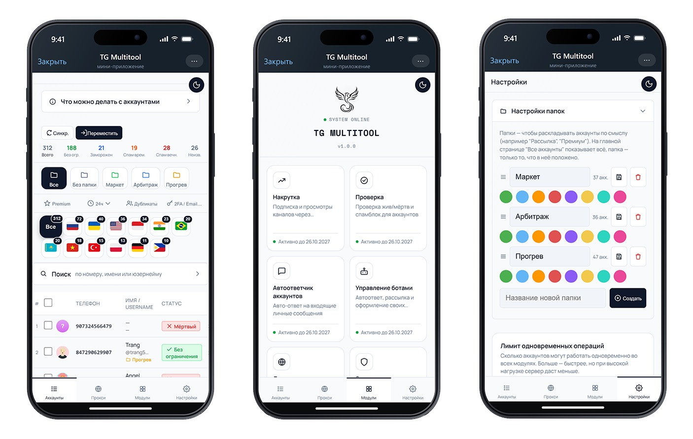

# Модули TG Multitool

**TG Multitool** - мини-приложение в Telegram для управления аккаунтами,
каналами и ботами. Работает прямо внутри Telegram, без установки программ
на компьютер или телефон.

| Модуль | Что делает |
|---|---|
| Создание сессии | Вход по номеру телефона для всех своих аккаунтов сразу, из интерфейса |
| Защита аккаунта | Регулярно проверяет список сессий и закрывает посторонние |
| Переавторизация | Восстанавливает рабочую сессию для аккаунта, который из неё вылетел |
| Проверка аккаунтов | Статус, спамблок, Premium - по списку аккаунтов одной кнопкой |
| Снятие спам-блока | Диагностика и снятие временных ограничений с аккаунта через SpamBot |
| Чекер каналов | Находит все каналы, где аккаунт реально владелец, и передаёт их |
| Оформление каналов | Массовая смена названия/описания/аватара каналов |
| Создание каналов | Массовое создание каналов и групп |
| Передача бота | Передача владения ботом на другой аккаунт через BotFather |
| Создание ботов | Массовое создание ботов по списку имён через BotFather |
| Управление ботами | Управление несколькими ботами из одного интерфейса |
| Автоответчик | Автоматический ответ на входящие сообщения для нескольких аккаунтов |
| Оформление аккаунта | Массовая смена имени/юзернейма/био/аватара аккаунтов |
| Розыгрыши | Проведение розыгрышей в каналах с проверкой условий участия |
| Накрутка | Просмотры и реакции на публикациях канала |
| Инвайтер | Массовое приглашение пользователей в группы и каналы |
| Stars Gift | Покупка и отправка Telegram Stars/подарков по списку аккаунтов |
| Парсер аудитории | Сбор аудитории из каналов и групп для последующей работы |
| Рассылка в ЛС | Массовая отправка сообщений по собранным спискам |
| Домен-редирект | Привязка собственного домена к ссылке на Telegram-бота/канал |

Подробнее: [tgmultitool.com](https://tgmultitool.com) · бот:
[@checker_accbot](https://t.me/checker_accbot)

## Подробные разборы

Отдельные темы разобраны подробнее, с примерами кода на Telethon:

- [Что такое спам-блок в Telegram и как его распознать](telegram-spamblock-diagnostics.md)
- [Как устроены сессии Telegram и зачем их хранить правильно](session-management.md)
- [Как защитить Telegram-аккаунт от чужих сессий: общий принцип](account-protection-telegram.md)
- [Лимиты Telegram на сообщения: как устроены ограничения при рассылках](telegram-messaging-limits.md)
